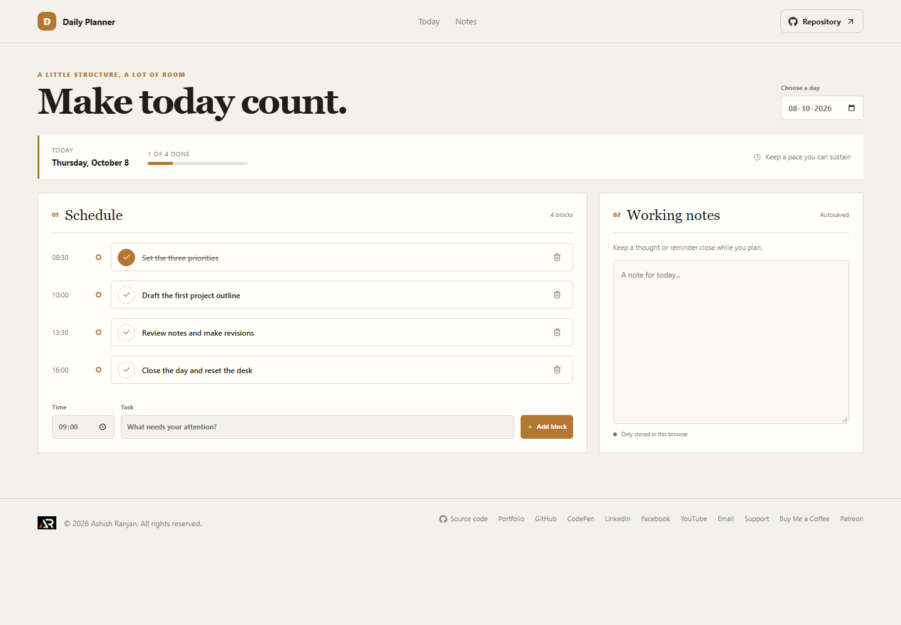

# Daily Planner

Daily Planner gives one day a clear schedule, a completion count, and space for working notes.

## Interface

The page combines a date picker, a progress summary, a chronological schedule, a quick-add row, and a notes panel.

## Features and use

Choose a date to switch the plan. Add a task with a time; entries sort by time. Mark a block complete or remove it after confirmation. Write a note in the working-notes area; the note saves as you type.

## Data and limits

Daily blocks and the notes field are stored in localStorage in the current browser. They remain on this device and are not synced. Browser data clearing removes them.

## Run locally

Use Node.js and npm, then run these commands from the project folder:

```sh
npm install
npm run dev
```

The app is built with React and Vite. Check the source and production build with:

```sh
npm run lint
npm run build
```

## Deployment

The public app is published with GitHub Pages at [https://a2rp.github.io/daily-planner/](https://a2rp.github.io/daily-planner/). To build and publish the current version, run:

```sh
npm run deploy
```

## Future improvements

Ideas that are not implemented yet:

- Drag-to-reorder blocks, reminders, and printable day plans.

## Links

- Portfolio: [https://www.ashishranjan.net](https://www.ashishranjan.net)
- GitHub: [https://github.com/a2rp](https://github.com/a2rp)
- CodePen: [https://codepen.io/ash1198](https://codepen.io/ash1198)
- LinkedIn: [https://www.linkedin.com/in/aashishranjan](https://www.linkedin.com/in/aashishranjan)
- Facebook: [https://www.facebook.com/theash.ashish/](https://www.facebook.com/theash.ashish/)
- YouTube: [https://www.youtube.com/@ashishranjan-ashz?sub_confirmation=1](https://www.youtube.com/@ashishranjan-ashz?sub_confirmation=1)
- Email: [mailto:ash.ranjan09@gmail.com](mailto:ash.ranjan09@gmail.com)

## Support

- Support: [https://a2rp-donation-page.netlify.app/](https://a2rp-donation-page.netlify.app/)
- Buy Me a Coffee: [https://buymeacoffee.com/ashishranjan](https://buymeacoffee.com/ashishranjan)
- Patreon: [https://www.patreon.com/ashishranjan](https://www.patreon.com/ashishranjan)